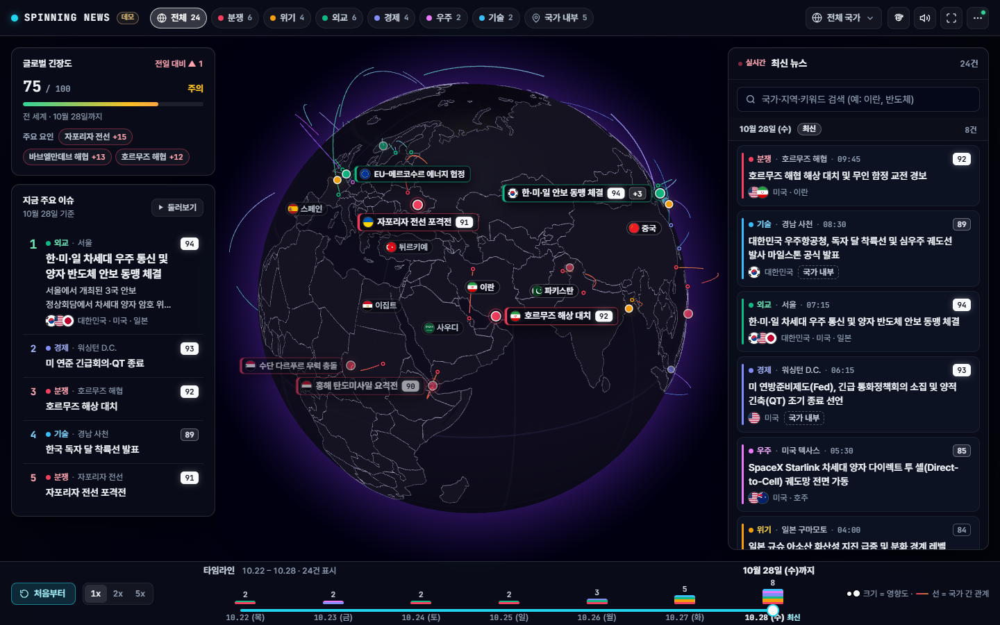
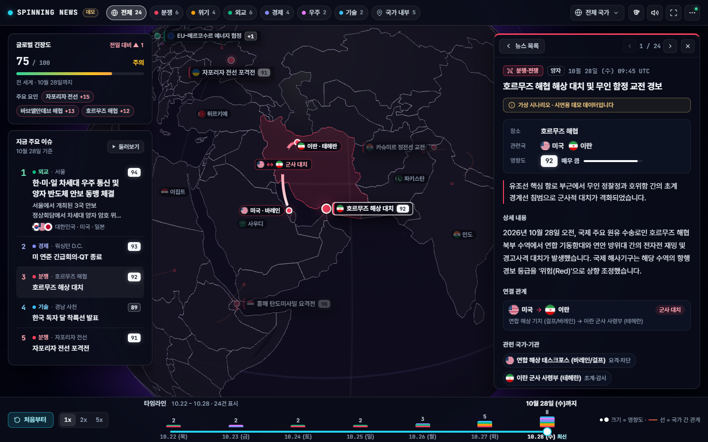
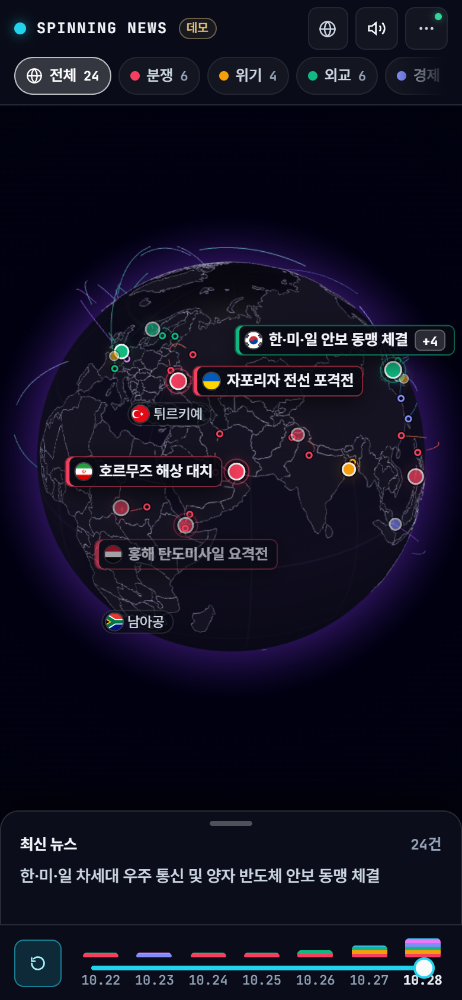

# 🌐 SPINNING NEWS — Open-Source 3D Geopolitical Intelligence & Newsfeed Radar

<div align="center">


-success?style=for-the-badge&logo=python)


<p align="center">
  <b>"The Grafana & FlightRadar for Global News, Geopolitical Conflicts, and Macro Threat Intelligence."</b><br/>
  <i>Plug your custom newsfeeds, RSS, GDELT, or AI scrapers straight into a high-performance, real-time 3D Globe with razor-thin glowing filament arcs.</i>
</p>

[🌍 Live Demo](https://souuul.github.io/spinning-news/) • [🚀 Quick Start](#-quick-start-under-60-seconds) • [⚡ Ingestion Pipeline](#-pluggable-data-pipeline-architecture) • [📡 REST API](#-rest-api--webhook-reference) • [🤖 AI Extractor](#-ai-news-to-3d-pipeline) • [🔒 Security](#-security) • [💰 Monetization](#-commercial-monetization-roadmap)

</div>

<p align="center">
  <a href="https://souuul.github.io/spinning-news/"></a>
</p>

<p align="center"><b><a href="https://souuul.github.io/spinning-news/">🌍 Open the live demo</a></b> — runs right in your browser with the bundled demo stories (live ingestion needs <code>python server.py</code>).</p>

<table>
  <tr>
    <td width="70%"></td>
    <td></td>
  </tr>
  <tr>
    <td align="center"><sub>Open a story: its arcs, parties and relation light up</sub></td>
    <td align="center"><sub>Phone layout</sub></td>
  </tr>
</table>

---

## 🛰️ Why Spinning News?

Modern news aggregation is broken: flat lists of headlines, endless twitter doom-scrolling, and no spatial context.

**SPINNING NEWS** transforms global news wires into a live, cybernetic 3D situational awareness console. Whether you are tracking **military conflicts, bilateral treaties, macro economic shifts, or disaster zones**, Spinning News connects events across continents using delicate, luminous fiber-optic filament curves inspired by aerospace mission control rooms.

> [!NOTE]
> **Demo data** — the stories bundled in `news-data.js` are **fictional scenarios made for this demo, not real news**. The app marks them with a **데모** badge in the header and a note in the story panel. Connect real feeds through the [REST API](#-rest-api--webhook-reference) or the RSS poller, or replace the stories and set `NEWS_DATA_IS_DEMO = false` in `news-data.js`.

---

## ⚡ Pluggable Data Pipeline Architecture

Spinning News is not a static demo—it is a **fully pluggable real-time intelligence engine**. You can pipe any data stream directly to the globe with a single HTTP POST request.

```mermaid
flowchart LR
    subgraph Sources ["1. Ingestion Sources (Adapters)"]
        RSS["📰 RSS Feeds (Reuters, BBC, Google News)"]
        GDELT["🌍 GDELT Open Conflict Database"]
        AI["🤖 LLM Extractor (Gemini / GPT / Ollama)"]
        Custom["⚡ Custom Microservice / Scraper / Webhook"]
    end

    subgraph Core ["2. Spinning News Core Engine (server.py)"]
        IngestAPI["POST /api/events (country code → coordinates)"]
        RSSPoller["POST /api/pipeline/poll-rss"]
        SSEBroker["GET /api/stream (SSE Broadcast Broker)"]
    end

    subgraph Client ["3. 3D WebGL Visualization (app.js)"]
        Globe3D["WebGL 3D Earth (60fps Razor Arcs)"]
        Audio["Web Audio Radar Ping & Chimes"]
        HUD["Live News Wire & DEFCON Tension Gauge"]
    end

    Sources --> IngestAPI
    Sources --> RSSPoller
    IngestAPI --> SSEBroker
    RSSPoller --> SSEBroker
    SSEBroker -->|Server-Sent Events| Client
```



---

## 🚀 Quick Start (Under 60 Seconds)

### 1. Zero-Install Native Python Server (Recommended)
Spinning News requires **zero external pip or npm packages**. It runs on the Python 3.8+ standard library. Clone or download this repository, then in the project folder:

```bash
# Run the real-time ingestion server
python server.py 8080
```

Open your browser at **[http://localhost:8080](http://localhost:8080)**. By default the server listens on `127.0.0.1`, i.e. this computer only — see [Security](#-security) to open it to other devices.

### 2. Direct File Mode (no server)
Double-click `index.html` in your file explorer. The globe and every interactive feature work with the bundled demo stories, without the Python server (`countries-data.js` stands in for the border download). You still need an internet connection: three.js, globe.gl, the fonts and the flag images load from CDNs. Live ingestion (API, SSE, RSS) needs the server. The [live demo](https://souuul.github.io/spinning-news/) on GitHub Pages runs the same way.

---

## 📡 REST API & Webhook Reference

### 1. Ingest Custom Geopolitical Event (`POST /api/events`)
Send a JSON object. If `lat`/`lng` are omitted, the event is placed at its country's coordinates (2-letter ISO codes such as `KR`, `US`, `CN`, `UA`, `IR`, `IL`), and two country codes automatically get a bilateral arc. Locally no token is needed:

```bash
curl -X POST http://localhost:8080/api/events \
  -H "Content-Type: application/json" \
  -d '{
    "title": "호르무즈 해협 군사 억제 연합 순찰 전개",
    "category": "conflict",
    "primaryCountry": "IR",
    "countryCodes": ["US", "IR"],
    "summary": "다국적 연합 해군이 주요 해상 통로 순찰을 전면 개시했습니다.",
    "impactScore": 92
  }'
```

When the server is exposed (`--host 0.0.0.0`) or `SPINNING_NEWS_TOKEN` is set, add the token:

```bash
curl -X POST http://your-host:8080/api/events \
  -H "Content-Type: application/json" \
  -H "Authorization: Bearer $SPINNING_NEWS_TOKEN" \
  -d '{"title": "서울 정상회담 개최", "category": "treaty", "primaryCountry": "KR"}'
```

* **Request rules**: `Content-Type: application/json`, a `Content-Length` header (no chunked uploads) and a body of at most 64 KB. Browser pages may write only from the app's own origin or from an origin listed in `SPINNING_NEWS_CORS_ORIGINS`; tools without an `Origin` header (curl, scripts) are fine.
* **Field rules**: the server rebuilds every event field by field before storing or broadcasting it. Country codes must be 2-letter ISO codes (anything else is dropped); `title` ≤ 200 characters, `summary` ≤ 1,000, `details` ≤ 5,000; `impactScore` 0–100; `date` as `YYYY-MM-DD`; at most 8 parties, arcs and sources and 10 tags; only `http(s)` source links are kept. Optional `brief` (short globe label, e.g. `"호르무즈 해상 대치"`) and `place` (place name shown in the feed), up to 60 characters each, are passed through. `"demo": true` marks a test event (the story panel shows a demo note). The server stamps `receivedAt` so stories keep their real age after a reload, and keeps the newest 200 events in memory.
* **Errors** come back as JSON `{"error": "...", "code": "..."}`: `400` (`bad_json`, `invalid_event`, `bad_request`), `401 unauthorized`, `403` (`forbidden_origin`, `bad_host`), `411 length_required`, `413 payload_too_large`, `415 unsupported_media_type`, `431` (headers over 64 KB), `503 server_busy` (too many connections, retry shortly).
* **Immediate Effect**:
  1. Unless you are reading a story or using the globe, it turns to the new location.
  2. A glowing, razor-thin luminous arc connects Washington and Tehran.
  3. A procedural radar ping audio chime sounds.
  4. The event appears at the top of the live news feed with a toast.

### 2. Live Server-Sent Events Stream (`GET /api/stream`)
Connect any frontend, mobile app, or terminal client to receive instantaneous event pushes. The first message is a `handshake`; every ingested story then arrives as `{"type": "new_event", "event": {...}}`:
```javascript
const sse = new EventSource("http://localhost:8080/api/stream");
sse.onmessage = (e) => {
  const msg = JSON.parse(e.data);
  if (msg.type === "new_event") console.log("⚡ New Geopolitical Event:", msg.event.title);
};
```
A browser page on another origin (for example a dashboard on `http://localhost:3000`) has to be allowed with `SPINNING_NEWS_CORS_ORIGINS=http://localhost:3000`; terminal and mobile clients are not affected by CORS.

### 3. One-Click RSS Feed Ingest (`POST /api/pipeline/poll-rss`)
Fetch an RSS or Atom feed (default: Google News, Korean edition) and turn its first 5 items into globe events. The country and category are guessed from keywords in each title:
```bash
curl -X POST http://localhost:8080/api/pipeline/poll-rss \
  -H "Content-Type: application/json" \
  -d '{"url": "https://news.google.com/rss/topics/CAAqJggKIiBDQkFTRWdvSUwyMHZNRGx1YlY4U0FtdHZHZ0pMVWlnQVAB"}'
```
* Only public `http(s)` feeds are fetched: private, loopback and link-local addresses are refused (`400 feed_not_allowed`), including after redirects. To poll a feed on your own network, set `SPINNING_NEWS_ALLOW_PRIVATE_FEEDS=1`.
* One poll every 5 seconds, refused URLs included (`429 rate_limited` with `Retry-After`); feeds up to 2 MB, about 20 seconds to download and no DTDs (`502 feed_fetch_failed` otherwise). The same write rules and token apply as for `POST /api/events`.

---

## 🤖 AI News-to-3D Pipeline

Turn unstructured raw news text into 3D globe events using AI. Complete scripts live in `pipeline/ai_extractor.py` and `pipeline/feeder_example.py`; both read `SPINNING_NEWS_URL` and `SPINNING_NEWS_TOKEN` from the environment:

```python
import json, os, urllib.request

BASE_URL = os.environ.get("SPINNING_NEWS_URL", "http://localhost:8080")
TOKEN = os.environ.get("SPINNING_NEWS_TOKEN")  # needed only when the server is exposed

def pipe_to_spinning_news(headline, country_from, country_to, category="conflict"):
    payload = {
        "title": headline,
        "category": category,
        "countryCodes": [country_from, country_to],
        "summary": "AI 자동 감지 지정학적 이상 징후",
        "impactScore": 88
    }
    headers = {"Content-Type": "application/json"}
    if TOKEN:
        headers["Authorization"] = f"Bearer {TOKEN}"
    req = urllib.request.Request(
        f"{BASE_URL}/api/events",
        data=json.dumps(payload).encode(),
        headers=headers
    )
    urllib.request.urlopen(req)

# Example: Feed an alert from an LLM agent
pipe_to_spinning_news(
    headline="[AI 긴급 감지] 남중국해 스프래틀리 군도 해상 초계정 조우",
    country_from="PH",
    country_to="CN",
    category="conflict"
)
```

---

## 🔒 Security

Spinning News is safe to run on your own computer out of the box; opening it to other devices is one deliberate step.

* **Local by default** — `python server.py` listens on `127.0.0.1` only and accepts only local `Host` headers (a defence against DNS rebinding).
* **Only the app is served** — the server answers with a fixed list of front-end files (`index.html`, `app.js`, `styles.css`, …). Nothing else in the folder is reachable, and there are no directory listings.
* **Guarded writes** — `POST` endpoints take JSON only, from tools without an `Origin` header, from the app's own origin, or from origins you list. Every event is rebuilt field by field before it is stored or broadcast.
* **Exposing it** — `python server.py 8080 --host 0.0.0.0` makes every write require a token. If `SPINNING_NEWS_TOKEN` is not set, a random token is generated and printed in the startup banner; send it as `Authorization: Bearer <token>`.
* **RSS fetches stay public** — the poller refuses private, loopback and link-local addresses, re-checks the address it actually connected to (also after redirects), caps feeds at 2 MB and rejects DTDs.

| Setting | Default | Meaning |
| :--- | :--- | :--- |
| `PORT` (first argument) | `8080` | TCP port |
| `--host` / `SPINNING_NEWS_HOST` | `127.0.0.1` | Bind address; anything other than a loopback address is exposed mode (writes need a token) |
| `SPINNING_NEWS_TOKEN` | — | Write token (`Authorization: Bearer …`); required whenever it is set |
| `SPINNING_NEWS_CORS_ORIGINS` | — | Comma-separated origins allowed to call the API from a browser (`*` = any origin, read endpoints only) |
| `SPINNING_NEWS_ALLOWED_HOSTS` | — | Extra `Host` names to accept, e.g. a LAN host name |
| `SPINNING_NEWS_ALLOW_PRIVATE_FEEDS` | — | `1` lets the RSS poller fetch private addresses |

**Limits**: JSON bodies ≤ 64 KB · request headers ≤ 64 KB, and a request must arrive within 30 s · 256 connections at once (`503 server_busy` beyond) · newest 200 events kept in memory · 100 live SSE streams, at most 10 per remote address (`503 too_many_streams`; local clients are exempt from the per-address limit, and the app reconnects by itself) · one RSS poll per 5 s · feeds ≤ 2 MB.

**Public deployments**: put the server behind a reverse proxy with HTTPS, set a long random `SPINNING_NEWS_TOKEN`, and list only origins you trust in `SPINNING_NEWS_CORS_ORIGINS`. Events live in memory and reset when the server restarts.

---

## 🎨 Design System & Performance Highlights

* **Signature Razor Arcs**: Ultra-thin luminous fiber-optic filament curves (`stroke: 0.18 ~ 0.38`, slightly bolder for higher-impact stories) that hug the Earth's curvature. Long routes are lifted just enough that the middle of the line never dips under the globe.
* **Information-first globe**: one mark per story at the place it happened (dot size = impact, colour = category) with a short Korean headline; party terminals are small rings. A throttled label engine keeps labels off each other, off story dots and off the panels (priority, zoom budgets, placement slots, "+N" clusters, hysteresis). Hovering or opening a story raises its arcs, party names ("이란 · 테헤란") and relation chips ("미국 ↔ 이란 · 군사 대치"); stories are framed inside the visible area between the panels, and a filter whose stories are all out of view turns the globe to them.
* **Readable HUD (Pretendard + JetBrains Mono)**: one category palette everywhere; category chips with counts double as the legend; country picker; "지금 주요 이슈" brief with a 둘러보기 tour; day-grouped news feed; a detail drawer that keeps the globe visible (a bottom sheet on phones/tablets); a timeline with per-day category density.
* **Pure Procedural Audio Synthesizer**: Web Audio API generates tactical beeps, radar pings, and harmonic treaty chimes on the fly—zero external audio files or network latency. Toggle with `M` (remembered per browser).
* **Keyboard & accessibility**: `/` search · `Esc` close · `← →` dates (or previous/next story) · `Space` play · `R` rotation · `F` fullscreen · `?` help (single-key shortcuts can be switched off there). Visible focus rings, focus always returns to where you were, hidden panels leave the tab order, dialogs keep focus inside, `prefers-reduced-motion` support, phone/tablet bottom sheet.
* **High-Performance WebGL**: country fills share single-pass materials (~40% fewer draw calls per frame), arcs restyle without per-frame rebuilds, markers are reused across filter changes, label layout runs at most every ~120 ms, playback pauses in hidden tabs, no CSS runtime, and the High-DPI pixel ratio is capped.

---

## 💰 Commercial Monetization Roadmap

How to build a business or generate revenue around this repository:

| Tier / Model | Target Customers | Revenue Potential | Description |
| :--- | :--- | :--- | :--- |
| **1. Hosted SaaS Dashboard** | Crypto Macro Traders, Hedge Funds, Geopolitical Analysts | **\$29 ~ \$99 / month** | Pre-connected premium threat feeds (Twitter API firehose, ACLED, GDELT, AIS marine tracking) with AI instant impact analysis and SMS/Telegram alerts. |
| **2. Enterprise White-Label Displays** | Defense Contractors, Media Newsrooms, Trading Desks, University Labs | **\$1,500 ~ \$5,000 / setup** | Turnkey deployment for video walls and executive boardrooms with custom branding and private internal data streams. |
| **3. Enriched Geopolitical API** | FinTech apps, risk management systems, prediction markets | **Usage-based API pricing** | High-speed structured geopolitical feed with geo-coordinates, DEFCON stress indices, and source credibility scoring. |
| **4. GitHub Sponsors & Open Core** | Open source community, developers | **Sponsorships & Grants** | Premium enterprise plugins (e.g., Starlink real-time telemetry, ADS-B flight radar integration). |

---

## 🗺️ Roadmap & Contributing

- [x] Zero-dependency Python 3 Realtime Ingestion Server
- [x] Server-Sent Events (SSE) Live 3D Globe Streaming
- [x] In-App Developer API & Webhook Testing Console
- [x] RSS / Atom feed adapter (country guessed from title keywords)
- [x] Secure-by-default server (local only, token when exposed, SSRF-safe RSS)
- [ ] GDELT Project live conflict database connector
- [ ] Twitter / X firehose keyword streaming agent
- [ ] Docker & Docker-Compose 1-click image
- [ ] Three.js bloom post-processing toggle

PRs, feature requests, and suggestions are welcome! Please check out [CONTRIBUTING.md](CONTRIBUTING.md).

---

## 🙏 Credits

* [three.js](https://threejs.org) (MIT) and [globe.gl](https://github.com/vasturiano/globe.gl) (MIT) for the 3D globe
* [Lucide](https://lucide.dev) icons (ISC)
* [Pretendard](https://github.com/orioncactus/pretendard) and [JetBrains Mono](https://www.jetbrains.com/lp/mono/) fonts (SIL Open Font License 1.1)
* Flag images from [flagcdn.com](https://flagcdn.com)
* Country borders from [Natural Earth](https://www.naturalearthdata.com) Admin-0 countries (public domain)

---

## 📄 License

Distributed under the **MIT License**. See [LICENSE](LICENSE) for more information.
